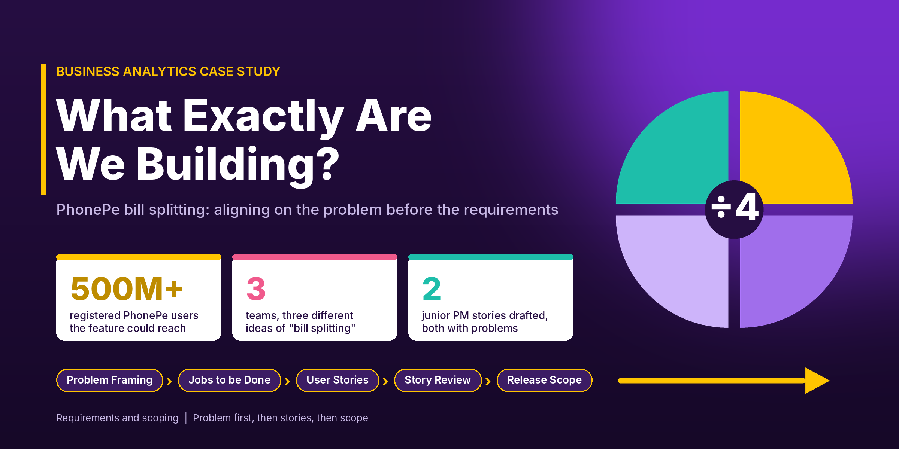

<h1 align="center">PhonePe — Bill Splitting: Problem Framing, User Stories & Release Scope</h1>

<p align="center">
  
  
  
  
</p>

<p align="center">
  
</p>

## Overview

PhonePe is one of India's leading digital payments platforms, with over 500 million registered users. A bill-splitting feature for groups, aimed at urban users who share expenses for rent, trips and dining, has been greenlit, but the team is not yet aligned on what is being built or why. The case study works through problem framing → requirements → user stories → story review → release scope, using 5W1H, jobs-to-be-done, the INVEST quality framework, Given/When/Then acceptance criteria and MoSCoW prioritisation.

## The Problem

| Signal | Detail |
|---|---|
| Teams with different ideas of "bill splitting" | **3** |
| Compliance questions on UPI transaction limits when splitting across users | **Unresolved** |
| Written problem statement (what, and for whom) | **None** |
| Junior PM stories written before any requirements discussion | **2** |
| Engineering needs a scope boundary | **Before next week's sprint planning** |

There is energy and intent, but no shared definition, no written problem and no scope boundary, so the work starts by framing the problem before any requirement is written.

## Frameworks Applied

| Framework | Used for |
|---|---|
| 5W1H | Framing who has the problem, what it is, when and where it happens, why it matters, and how it is handled today |
| Jobs to be done | Describing the functional, emotional and social jobs behind splitting a bill |
| Business needs vs. product requirements | Separating what the company needs from what the product must do |
| User stories + Given/When/Then | Turning requirements into stories with testable acceptance criteria |
| INVEST | Evaluating the junior PM's stories and rewriting them for development |
| MoSCoW + decision criteria | Drawing the first-release scope boundary and explaining each call |

## Approach

1. **Problem Framing** — Wrote a crisp problem statement with 5W1H and supported it with a jobs-to-be-done view (below).
2. **Requirements** — Separated business needs from product requirements.
3. **User Stories** — Wrote three stories, each with Given/When/Then acceptance criteria.
4. **Story Review** — Evaluated the junior PM's two stories against INVEST and rewrote them.
5. **Release Scope** — Used MoSCoW and four decision criteria to set what is in and out of the first release.

## Key Insights

- **The real problem is collecting money back, not doing the maths** — The person who pays upfront fronts the cost and then chases friends for their share, while the arithmetic is the easy part. (Assumption, to validate with user research.)
- **Compliance is a scope driver, not a late check** — Whether UPI limits apply per member or per request shapes the design, so it must be confirmed before sprint planning.
- **"Bill splitting" must mean one thing** — Without a single shared definition, three teams will build three different features.
- **Story 2 is an epic in disguise** — It bundles seven capabilities, including two with unresolved compliance and privacy questions, so it cannot be estimated or tested as written.

**Problem statement (5W1H)**

| Question | Answer |
|---|---|
| Who | Urban users, mainly the person who pays a shared bill upfront (the "organiser"), plus the friends, flatmates or colleagues who owe a share |
| What | Getting each person's share back accurately and without awkward chasing |
| When | After shared rent, trip or dining expenses |
| Where | Today, mostly outside PhonePe: calculators, chats and separate payments |
| Why it matters | Unsettled balances cause friction and delay, and the payment moment drops out of the app |
| How today | Manual maths, individual messages and separate payments, with no single record |

**Crisp problem statement:** *Urban users who pay shared expenses upfront have no simple way to work out each person's share and collect it from everyone in one place, so they do the maths by hand and chase friends individually, and balances stay unsettled.*

**Jobs to be done:** *When I pay a shared bill upfront, I want everyone to pay me their exact share quickly, so I don't float the cost or feel awkward chasing friends.*

| Job type | Job |
|---|---|
| Functional | Calculate each share accurately and collect it |
| Emotional | Feel fair and not awkward about asking for money |
| Social | Be seen as reasonable and organised by the group |

**Business needs vs. product requirements**

| Business needs (why) | Product requirements (what the product must do) |
|---|---|
| Increase usage frequency among urban users | Let an organiser create a group expense and split it |
| Grow UPI transaction volume inside PhonePe | Send each member a payment request for their exact share |
| Stay compliant with UPI rules | Respect applicable UPI limits on every request |
| Build trust and avoid disputes | Show clear status for each member |

**User stories and acceptance criteria**

*Story A: Split a bill equally.* As an organiser who has paid a shared bill, I want to enter the total and choose the members so that each person's equal share is calculated automatically.
- **Given** I enter a total above ₹0 and select 2 to 10 PhonePe users (assumed limit for release 1), **when** I confirm, **then** each member's share is shown.
- **Given** the total does not divide evenly, **when** shares are calculated, **then** the shares add up exactly to the total, with any remainder rounded onto the organiser's share.
- **Given** the split is shown, **when** I review it, **then** I can edit the members or total before anything is sent.

*Story B: Request payment in one action.* As an organiser, I want to send a payment request to every member at once so that I don't have to message each person separately.
- **Given** a confirmed split, **when** I tap send, **then** each member receives a notification with their exact amount and the group name.
- **Given** a member's share exceeds the applicable UPI limit (to be confirmed by compliance), **when** I try to send, **then** the request is blocked with a clear message.
- **Given** a member has not paid, **when** I cancel the request, **then** it is withdrawn and the member can no longer pay it.

*Story C: Track who has paid.* As an organiser, I want to see who has paid and who hasn't so that I know what is still owed.
- **Given** requests have been sent, **when** I open the expense, **then** each member shows as Paid, Pending or Declined.
- **Given** a member has not paid, **when** I tap remind, **then** one reminder is sent, limited to one per member per 24 hours (assumed rule).
- **Given** every member has paid, **when** the last payment arrives, **then** the expense is marked Settled.

**Review of the junior PM's stories (INVEST)**

| INVEST | Story 1: "As a user, I want to split bills so that it is easier." | Story 2: "As a PhonePe user, I want the app to automatically calculate each person's share, send payment requests to all group members at once, allow partial payments, send reminders to people who have not paid, show a settlement summary, and sync with my UPI transaction history so that managing group expenses is seamless." |
|---|---|---|
| Independent | Passes | Fails: bundles many features that depend on each other |
| Negotiable | Passes | Fails: dictates the solution rather than the need |
| Valuable | Weak: "easier" is not a benefit anyone can verify | Weak: "seamless" is vague |
| Estimable | Fails: too vague to size | Fails: it is several stories in one |
| Small | Passes | Fails: far too large for a sprint |
| Testable | Fails: no way to tell when it is done | Fails: no acceptance criteria and untestable wording |

Story 1 uses a generic "user", names no object and gives no measurable benefit. Story 2 is an epic that also hides two risks: partial payments and UPI-history sync both raise compliance and privacy questions that are still open.

**Rewrites:** Story 1 becomes **Story A** (specific persona, concrete action and a checkable result). Story 2 is broken up: automatic calculation goes into Story A, the one-action request into **Story B**, and reminders and the settlement summary into **Story C**. Partial payments and UPI-history sync move out of release 1 for the reasons below.

**Release 1 scope (MoSCoW)**

| Item | Decision | Why |
|---|---|---|
| Group expense with equal split | **In (Must)** | The core job, with low engineering effort |
| One-action payment requests | **In (Must)** | The part that solves chasing for payment |
| Status tracking per member | **In (Must)** | Organisers need to see who still owes |
| Manual reminder (limited) | **In (Should)** | High value and low risk, with a cap to avoid spam |
| Unequal or custom splits | Out (Next release) | Valuable for trips and rent, but adds design and edge-case work |
| Partial payments | Out (Next release) | Open compliance questions and ledger complexity |
| UPI transaction-history sync | Out (Later) | Needs user consent, privacy and data-handling review |
| Automatic reminders | Out (Later) | Needs rules to avoid spam, and manual reminders give a first signal |
| Members not on PhonePe | Out (Later) | Different onboarding and payment flow |
| Recurring bills (rent) | Out (Later) | Builds on a stable one-off flow |

**How the scope was decided:** each item was scored against four criteria: value to the core job, compliance risk, engineering effort, and whether it depends on something unresolved. Items that were high value, low risk and low effort went in; items with open compliance or privacy questions went out until those are settled. One call must be made before sprint planning: compliance confirms whether UPI limits apply to each member's own payment or to the whole split.

## Recommendations

| # | Recommendation |
|---|---|
| 01 | Adopt one shared definition: one person pays a shared expense upfront, splits it among a group and collects each share back |
| 02 | Pause the junior PM's stories and replace them with Stories A, B and C |
| 03 | Get compliance to confirm UPI limit treatment per member before sprint planning |
| 04 | Ship release 1 with equal splits, one-action requests, status tracking and limited manual reminders |
| 05 | Validate the "collecting money back" assumption with a few user interviews, then decide on custom splits and partial payments |

## Repository Structure

```
phonepe-bill-split-case-study
├── PhonePe_Case_Study.pdf    ← Full case study deck (add your file here)
├── cover.png                 ← Repo cover image
└── README.md
```

---

## About Me

**Anmol Agarwal**
Business Analyst

[](https://www.linkedin.com/in/anmol-agarwal123/)
[](https://github.com/Anmolagarwal19)
[](mailto:agarwalanmol799@gmail.com)

*If this project was useful, a star on the repo is appreciated — feel free to reach out for feedback, questions, or opportunities.*
